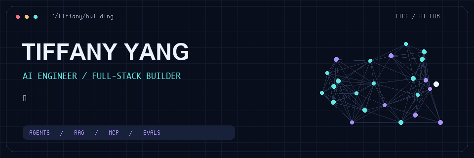
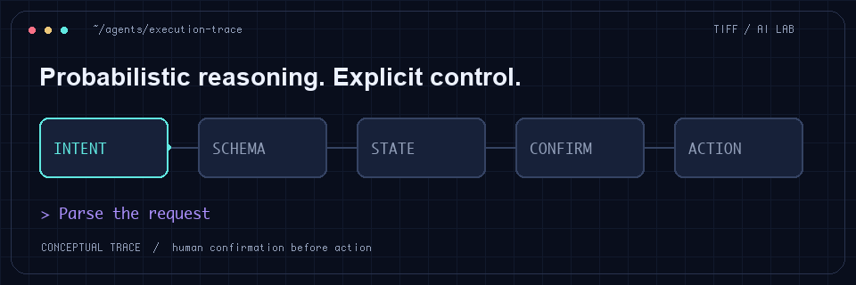
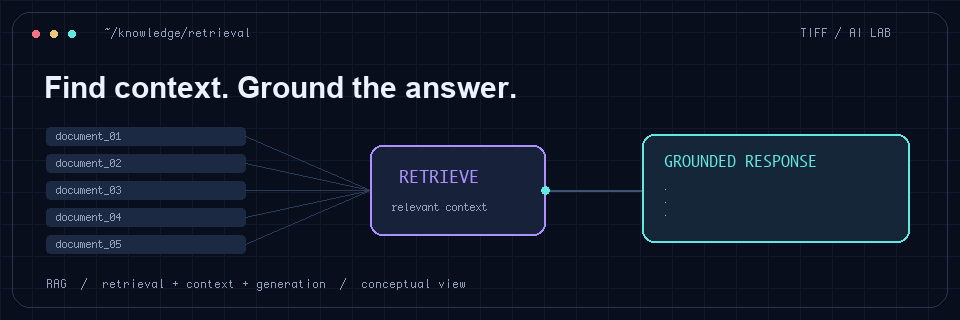

  

I build AI-powered products with clear workflows, grounded answers, and human control.

My work spans agent orchestration, structured extraction, retrieval, MCP tools, and evaluation — alongside the full-stack engineering that makes a product usable.

[Explore Snowza](https://snowza.vercel.app) · [GitHub](https://github.com/tiff0000)

### From intent to action

In my Snowza booking workflow, models interpret intent; explicit state and transaction checks control booking. A person confirms before the action runs.

### Context before answers

I work on retrieval, bilingual extraction, and evaluation, using observed failures to guide improvements.

**Tools I work with:** TypeScript · Python · React · NestJS · PostgreSQL · LangGraph · OpenAI Agents SDK · MCP · XState

### A little motion

<picture>
  <source media="(prefers-color-scheme: dark)" srcset="https://raw.githubusercontent.com/Austin5925/Austin5925/output/github-contribution-grid-snake-dark.svg">
  <source media="(prefers-color-scheme: light)" srcset="https://raw.githubusercontent.com/Austin5925/Austin5925/output/github-contribution-grid-snake.svg">
  
</picture>
<!---
tiff0000/tiff0000 is a ✨ special ✨ repository because its `README.md` (this file) appears on your GitHub profile.
You can click the Preview link to take a look at your changes.
--->
