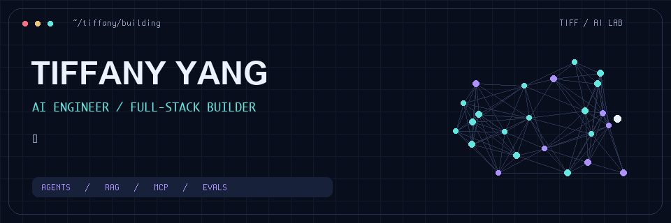
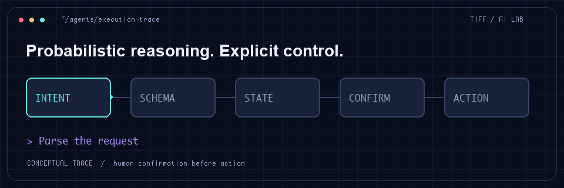

  

I build AI-agent products.

### From intent to action

In my booking app workflow, models interpret intent; explicit state and transaction checks control booking. A person confirms before the action runs.

**Tools I work with:** TypeScript ·  React · NestJS · Python · PostgreSQL · LangChain · LangGraph · OpenAI Agents SDK ·

<picture>
  <source media="(prefers-color-scheme: dark)" srcset="https://raw.githubusercontent.com/Austin5925/Austin5925/output/github-contribution-grid-snake-dark.svg">
  <source media="(prefers-color-scheme: light)" srcset="https://raw.githubusercontent.com/Austin5925/Austin5925/output/github-contribution-grid-snake.svg">
  
</picture>
<!---
tiff0000/tiff0000 is a ✨ special ✨ repository because its `README.md` (this file) appears on your GitHub profile.
You can click the Preview link to take a look at your changes.
--->
